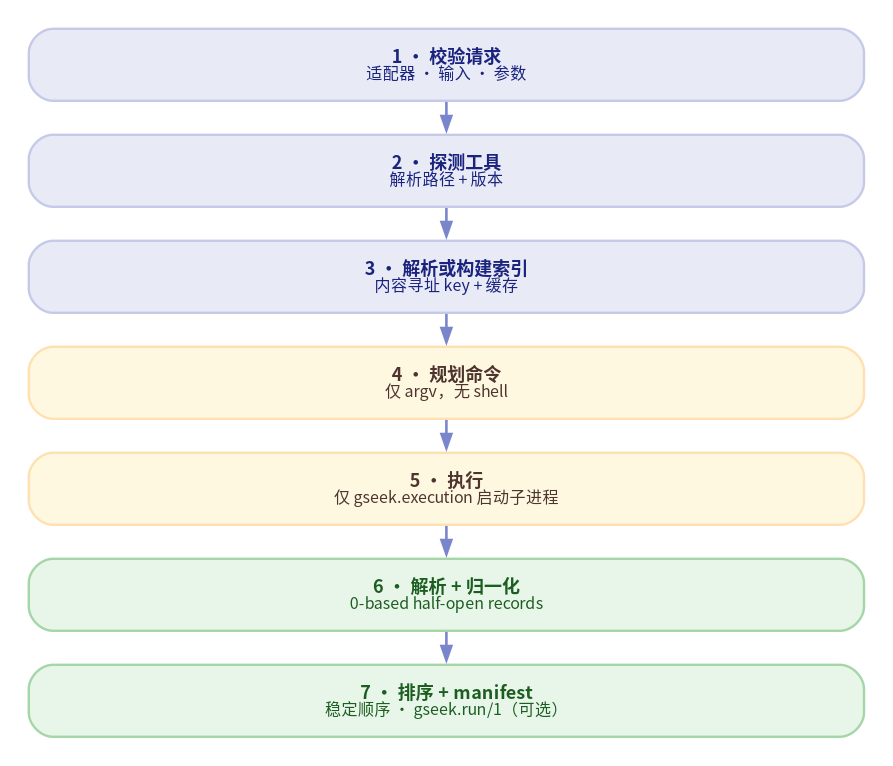

# gseek API 参考

[English](https://indexofire.github.io/gseek/api/) | **简体中文**

> 版本：0.10.2<br>
> Python：>=3.12<br>
> 源码基准：`src/gseek/`<br>
> 新用户请先读 [Quickstart](quickstart.zh.md)。

## 0. 当前状态

M0 基座与 M1–M4 适配器已实现。

| 后端 | 输入 | 索引 | 操作 |
| --- | --- | --- | --- |
| `blast` | FASTA | target | 比对（DNA/蛋白任务） |
| `minimap2` | FASTA / FASTQ / paired | target | 比对 |
| `kma` | FASTA / FASTQ / paired | target | 比对 |
| `mummer` | FASTA | 无 | 比对（MUMmer 4） |
| `bwa` | FASTA / FASTQ / paired | target | 比对 |
| `mash` | FASTA / FASTQ | sketch | 距离 / screen |
| `sourmash` | FASTA / FASTQ | sketch | search / gather |
| `skani` | FASTA | sketch | ANI 距离 |

下文所有符号都可以从顶层包导入：

```python
import gseek

gseek.__version__        # "0.10.2"
gseek.ALIGNMENT_SCHEMA   # "gseek.alignment/1"
gseek.DISTANCE_SCHEMA    # "gseek.distance/1"
gseek.RUN_SCHEMA         # "gseek.run/1"
gseek.INDEX_SCHEMA       # "gseek.index/1"
```

## 1. 核心概念

### 1.1 一次运行



适配器只规划 argv、解析输出；`gseek.execution` 是唯一启动子进程的层。Runner
负责编排与 provenance。

### 1.2 坐标

所有坐标都是**基于正向序列的 0-based half-open**。方向单独存放在 `strand`
（`+` / `-`）中。适配器不得输出 1-based inclusive 坐标。

### 1.3 Identity 与 coverage

`identity` 是 `[0, 100]` 的百分比；coverage 是 `[0, 1]` 的比例。把来源保存在
`tags`（例如 `identity_method`）中，尤其是工具使用非直观公式计算 identity 时。

### 1.4 无损 records

归并是显式视图（`best_per_query_target`、`primary_only`、`best_per_query`），
不是对 `records` 的修改。消费者始终可以查看原始行。

### 1.5 稳定顺序

`AlignmentResult` 与 `DistanceResult` 按稳定 key 确定性排序。不要依赖工具的
输出顺序。

## 2. 公共 API

### 2.1 `gseek.align`

```python
gseek.align(
    *,
    query: Path | str | Sequence[Path | str],
    target: Path | str | Sequence[Path | str],
    backend: str | None = None,
    adapter: AlignmentAdapter | None = None,
    query_kind: InputKind | str | None = None,
    paired: bool = False,
    params: Mapping[str, JsonValue] | None = None,
    preset: str | None = None,
    threads: int = 1,
    timeout_s: float | None = None,
    index: IndexPolicy | str = IndexPolicy.AUTO,
    target_filter: Iterable[str] | None = None,
    work_dir: Path | str | None = None,
    keep_work: bool = False,
    manifest: Path | str | None = None,
    record_manifest: bool = True,
    resolver: ToolResolver | None = None,
    executor: Executor | None = None,
    store: IndexStore | None = None,
) -> AlignmentResult
```

| 参数 | 含义 |
| --- | --- |
| `query` | 一个文件；`paired=True` 时两个文件 |
| `target` | 一个或多个 target FASTA |
| `backend` | 已注册的适配器名；与 `adapter` 互斥 |
| `adapter` | 显式适配器实例（插件/测试） |
| `query_kind` | 覆盖 `"fasta"` / `"fastq"`；默认自动检测 |
| `paired` | 把两个 query 路径视为双端 |
| `params` | 适配器特定参数 |
| `preset` | `params["preset"]` 的简写 |
| `threads` | 工具线程数；会记录，但不参与 recipe hash |
| `timeout_s` | 单条命令超时 |
| `index` | `auto` / `reuse` / `rebuild` / `none` |
| `target_filter` | 传给适配器的可选 target ID |
| `work_dir` | 临时 workspace 的父目录 |
| `keep_work` | 保留 workspace 以便调试 |
| `manifest` | 写出 `gseek.run/1` manifest |
| `record_manifest` | 为 `False` 时跳过 manifest/结果哈希，适合低延迟调用方 |
| `resolver` / `executor` / `store` | 注入自定义基础设施 |

如果 `backend` 与 `adapter` 都省略，gseek 会按输入/输出/paired 能力筛选已注册
适配器。必须恰好剩一个候选；零个或多个候选都会抛 `ConfigError`，而不是猜测。

常见错误：`ConfigError`、`UnsupportedFeatureError`、`ToolNotFoundError`、
`ToolVersionError`、`ExecutionError`、`ParseError`、`IndexBuildError`。

后端说明：

| 后端 | 说明 |
| --- | --- |
| `blast` | DNA/蛋白任务；FASTA；无 `preset`；`index=none` 使用 `-subject` |
| `minimap2` | 需要 preset；FASTA/FASTQ；支持 paired；默认只保留 primary |
| `kma` | 需要 target 索引；无坐标；仅 FASTQ 有 depth |
| `mummer` | 仅 FASTA；MUMmer 4.x；无持久索引 |
| `bwa` | 需要 target 索引；SAM/CIGAR；默认跳过 secondary |
| `mash` | 默认 `dist`；read screening 用 `params={"mode":"screen"}` |
| `sourmash` | 每次调用一个 query 文件；`containment` 切换语义 |
| `skani` | 仅 FASTA；sketch 数据库；返回 ANI + aligned fraction |

### 2.2 `gseek.distance`

```python
gseek.distance(
    *,
    query: Path | str | Sequence[Path | str],
    reference: Path | str | Sequence[Path | str],
    backend: str | None = None,
    adapter: DistanceAdapter | None = None,
    query_kind: InputKind | str | None = None,
    params: Mapping[str, JsonValue] | None = None,
    threads: int = 1,
    timeout_s: float | None = None,
    index: IndexPolicy | str = IndexPolicy.AUTO,
    external_reference: bool = False,
    external_sha256: str | None = None,
    external_size: int | None = None,
    work_dir: Path | str | None = None,
    keep_work: bool = False,
    manifest: Path | str | None = None,
    record_manifest: bool = True,
    resolver: ToolResolver | None = None,
    executor: Executor | None = None,
    store: IndexStore | None = None,
) -> DistanceResult
```

用于 mash、sourmash 与 skani；没有比对坐标。

`external_reference=True` 表示 `reference` 已经是构建产物而不是 FASTA：`.msh`、
`.sig`/`.zip`、sourmash rocksdb 目录或 skani database 目录。这种情况下 gseek
跳过 reference 索引，直接对产物做哈希（目录使用确定性 tree hash；拒绝符号链接）。

### 2.3 注册表查询

```python
gseek.backends() -> tuple[BackendSpec, ...]
gseek.find(
    *,
    input: InputKind | str | None = None,
    output: OutputKind | str | None = None,
    paired: bool | None = None,
    molecule: Molecule | str | None = None,
) -> tuple[BackendSpec, ...]
gseek.find_backends(...)  # alias
```

`BackendSpec.capabilities` 描述 `inputs`、`outputs`、`molecule`、`paired`、
`index_scope`、`streaming`、`threads`、`presets` 与 `deterministic`。

### 2.4 获取/注册适配器

```python
adapter = gseek.get_backend("minimap2")
result = gseek.align(
    adapter=adapter,
    query="sample.fna",
    target="alleles.fna",
    preset="asm5",
)

gseek.register_adapter(MyAdapter)
gseek.register_adapter(MyAdapter, replace=True)
```

`register_adapter` 接受类或实例；重名会抛 `ConfigError`，除非 `replace=True`。
插件也可以使用 `gseek.adapters` entry-point 组。

### 2.5 校验 manifest

```python
issues = gseek.verify("runs/sample.manifest.json")
for issue in issues:
    print(issue.severity, issue.code, issue.message)
```

`verify` 检查记录的文件大小/SHA-256，不会重新探测工具或重跑。

### 2.6 回放

```python
from pathlib import Path
import gseek

result = gseek.replay(Path("runs/sample.manifest.json"), check=True)
print(result.matches, result.issues)
```

Replay 按 manifest 让适配器重新规划；绝不执行保存的 argv。`check=True` 会比较
新的结果哈希，并抛出/报告不一致。

### 2.7 消费者切换：`gseek.compat`

```python
from gseek.compat import Engine

engine = Engine.from_env("GAPIT_ENGINE")  # legacy (default) | gseek | shadow

result = engine.run(
    legacy=run_legacy,
    gseek=run_gseek,
    compare=compare_results,  # optional; default ==
)
```

- `legacy`：只用旧实现；不导入 gseek 适配器。
- `gseek`：只用 gseek；异常向外传播。
- `shadow`：两边都跑并比较，返回 legacy；gseek/比较器失败时记录日志并回退到
  legacy。

调用方在把流式迭代器交给 `run` 之前，需要先物化（materialize）。

## 3. 结果模型

### 3.1 `AlignmentRecord`

关键字段：

```text
query_id, target_id
query_length, target_length
query_start, query_end, target_start, target_end
strand
identity, aligned_length, matches, mismatches,
gap_count, gap_openings
evalue, bit_score, mapq, depth, score
query_coverage, target_coverage
query_aligned, target_aligned, target_description
is_primary, is_supplementary
tags
```

`AlignmentRecord.stable_key` 定义确定性排序。

### 3.2 `AlignmentResult`

```text
backend, records, inputs, targets, params, stats
index (IndexRef | None), manifest (RunManifest | None)
warnings, errors, schema
```

视图：

- `primary_only()` — primary 且非 supplementary 的 records。
- `best_per_query_target()` — 每个 query/target 按
  `(identity, aligned_length, query_coverage, target_coverage)` 取最佳行；
  平局保留第一行。
- `summarize_by_target()` — 聚合计数。
- 迭代/`len()` 作用于规范化、已排序的 records。

### 3.3 `DistanceRecord` / `DistanceResult`

字段：`query_id`、`reference_id`、`distance`、`pvalue`、`shared_hashes`、
`total_hashes`、`containment`、`jaccard`、`ani`、`aligned_fraction`、`tags`。

`DistanceResult` 包含 `backend`、`records`、`inputs`、`references`、`params`、
`stats`、`index`、`manifest`、`warnings`、`errors`、`schema`；提供
`best_per_query()`。

### 3.4 Provenance 引用

- `InputRef`：path、kind（`fasta`/`fastq`/`sketch`）、SHA-256、size。
- `ToolRef`：binary、path、version。
- `IndexRef`：key、adapter/version、entry、source hash、artifacts、params、
  cache-hit 标志、tool versions。
- `CommandRecord`：argv、cwd、exit code、duration、stdout/stderr 哈希。
- `RunManifest`：schema、run ID、时间戳、inputs、tools、index、commands、
  params、result hash、环境 allowlist、issues。

## 4. 适配器 API

### 4.1 协议

适配器实现：

```python
class MyAdapter:
    spec: BackendSpec

    def probe(self, resolver, *, strict=True): ...
    def plan_index(self, request: IndexRequest, ctx: PlanContext) -> IndexPlan: ...
    def plan_align(self, request: AlignRequest, index: IndexRef | None,
                   ctx: PlanContext) -> AlignPlan: ...
    def parse_align(self, ctx: ParseContext, lines: Iterable[str]) -> Iterable[AlignmentRecord]: ...
```

距离适配器使用 `DistanceRequest` / `DistancePlan` / `DistanceRecord`。适配器不得
直接调用 `subprocess`。

### 4.2 请求与上下文

`AlignRequest` 携带 query/target 路径、检测到的 kind、paired 标志、params、
threads、timeout、index policy、target filter 与 workspace policy。
`PlanContext` 携带 workspace、index 目录与环境。

### 4.3 能力声明

在 `BackendSpec` / `Capabilities` 中声明 inputs、outputs、molecule、paired
支持、index scope、streaming、threads、presets 与确定性。Runner 用这些信息做
自动适配器选择与校验。

### 4.4 最小适配器

```python
from gseek.adapter import BaseAdapter
from gseek.capabilities import BackendSpec, Capabilities, ToolRequirement
from gseek.execution import CommandPlan

class MyAdapter(BaseAdapter):
    spec = BackendSpec(
        name="myalign",
        family="myalign",
        summary="example aligner",
        capabilities=Capabilities(...),
        tools=(ToolRequirement(binary="myalign", role="aligner"),),
    )

    def plan_align(self, request, index, ctx):
        return AlignPlan(commands=(CommandPlan(argv=("myalign", ...)),))
```

使用 `@pytest.mark.integration`，二进制缺失时跳过。适配器测试必须覆盖命令规划、
golden 解析（正向/反向/gapped/空结果）、坐标归一化、identity/coverage 来源、
索引 key 与错误路径。

### 4.5 插件入口点

第三方适配器注册到 `gseek.adapters` entry-point 组；注册表会延迟导入它们。

## 5. 执行层

### 5.1 `CommandPlan`

命令计划由 argv 元组、label、cwd、环境覆盖、stdin、输出捕获模式与 timeout
组成。没有 shell 字符串。

### 5.2 `Executor`

职责：

- 解析二进制并以 argv 列表运行；
- 设置 `LC_ALL=C`、确定性环境与绝对路径；
- 执行超时、排空 stderr、支持流式输出；
- 返回 exit code/stdout/stderr，不解释工具语义。

### 5.3 `ToolResolver`

从 PATH 与显式覆盖中查找二进制，探测版本，按进程缓存结果，并对缺失/过旧工具
抛出类型化错误。

### 5.4 环境变量

| 变量 | 含义 |
| --- | --- |
| `GSEEK_CACHE_DIR` | 索引缓存根目录 |
| `GSEEK_<BINARY>` | 显式工具路径，例如 `GSEEK_BLASTN` |
| `GSEEK_*_TIMEOUT` | 支持时的单工具超时覆盖 |
| `LC_ALL` | 工具执行时强制为 `C` |

密钥永远不会写入 manifest；只记录 allowlist 中的环境变量值。

### 5.5 Workspace

`RunWorkspace` 为每次运行分配临时目录，支持清理，并可通过 `keep_work=True`
保留用于调试。所有输出路径必须位于 workspace 或 index staging 目录内。

## 6. 索引层

### 6.1 策略

`IndexPolicy`：`auto`、`reuse`、`rebuild`、`none`。

- `auto`：复用匹配的缓存条目，或构建一个。
- `reuse`：要求缓存命中。
- `rebuild`：失效并重建。
- `none`：不使用持久索引（适配器支持 subject 模式时）。

### 6.2 内容寻址 key

key 包含适配器名/版本、语义参数、target 内容 SHA-256 与工具版本。`threads`、
`timeout` 等非语义值被排除。不做 mtime 判断。

### 6.3 缓存布局与 GC

索引按 key 存放在缓存根目录下，带锁文件、staging 目录与原子发布。`IndexStore`
支持 lookup、build、purge 与垃圾回收。`gseek index gc` 默认 dry-run，只有传
`--apply` 才执行。

## 7. 可复现性与 manifest

### 7.1 哈希

- `sha256_file`、`sha256_tree`（确定性 tree hash；拒绝符号链接）
- `canonical_json` / `sha256_json`
- `result_hash` 基于排序后的规范化 records

### 7.2 `recipe_hash`

recipe hash 捕获语义操作：适配器、语义参数、输入、索引 key 与工具版本。在相同
输入/工具的主机之间保持稳定。

### 7.3 Manifest

`gseek.run/1` 记录：

```json
{
  "schema": "gseek.run/1",
  "run_id": "...",
  "created_at": "...",
  "inputs": [],
  "tools": [],
  "index": null,
  "commands": [],
  "params": {},
  "result_hash": "...",
  "environment": {},
  "issues": []
}
```

`write_manifest`/`read_manifest` 负责模型往返；`verify_manifest` 检查记录的文件
哈希；`replay` 重新规划并可比较 `result_hash`。

## 8. I/O 与视图

- `gseek.io`：FASTA/FASTQ 读取、行归一化、`merge_fasta`。
- `gseek.views`：供消费者使用的显式 record 视图。
- 适配器不得在自身 workspace 之外写文件。

## 9. 错误

完整错误表见[错误模型](errors.zh.md)。所有类型化失败都继承 `GseekError`，带有
`code`、`message`、`context`、`hint` 与 `exit_code`。

## 10. CLI

见 [CLI 参考](cli.zh.md)。CLI 是 API 的薄封装；它的 JSON 输出与退出码是自动化
契约的一部分。

## 11. Schema

稳定 schema 字符串：

```text
gseek.alignment/1
gseek.distance/1
gseek.run/1
gseek.index/1
gseek.error/1
```

alignment record 示例：

```json
{
  "query_id": "contig1",
  "target_id": "allele_1",
  "query_start": 100,
  "query_end": 580,
  "target_start": 0,
  "target_end": 480,
  "strand": "+",
  "identity": 99.79,
  "aligned_length": 480,
  "target_coverage": 1.0,
  "query_coverage": 1.0,
  "tags": {"identity_method": "blast_pident"}
}
```

Schema 带版本；破坏性变更必须使用新的 schema 字符串。

## 12. 稳定性与限制

- `0.10.2` 是当前版本；生产环境请固定版本。1.0 之前公共 API 仍可能变化。
- 迁移期间可通过 `gseek.compat` 保留 legacy 路径。
- 各工具的后端覆盖不同；见顶部矩阵。
- Manifest replay 要求相同的适配器/工具版本；环境变化可能合理地改变结果，并会
  报告为 replay 不一致。
- 返回[文档首页](index.zh.md)或 [English API reference](https://indexofire.github.io/gseek/api/)。
