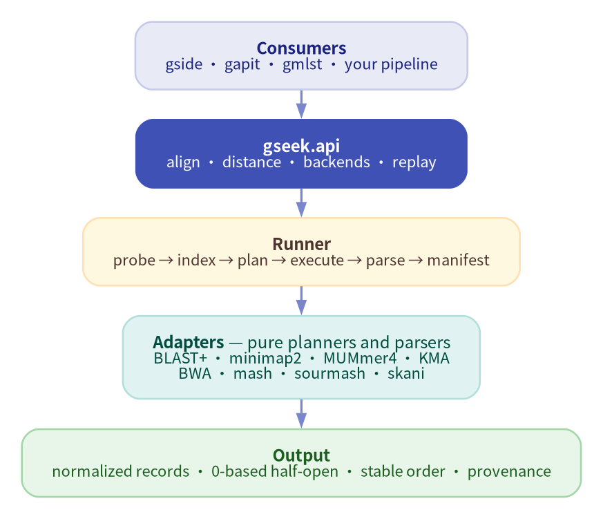

<div class="gseek-hero" markdown>

# gseek

**One reproducible alignment layer for eight DNA tools.**

`gseek` turns BLAST+, minimap2, MUMmer4, KMA, BWA, mash, sourmash, and skani
into one request/result model — with content-addressed indexes, lossless
records, and replayable run manifests. It is pure Python: zero runtime
dependencies.

<span class="gseek-badge">Python ≥ 3.12</span>
<span class="gseek-badge">8 backends</span>
<span class="gseek-badge">stdlib only</span>
<span class="gseek-badge">MIT</span>

[Quickstart](quickstart.md){ .md-button .md-button--primary }
[Tutorial](tutorial.md){ .md-button }
[API reference](api.md){ .md-button }

</div>

## Why gseek

<div class="grid cards" markdown>

-   **One record model**

    ---

    BLAST outfmt, PAF, SAM, KMA, and MUMmer output normalize into the same
    `AlignmentRecord` / `DistanceRecord`, with coordinates, identity, and
    coverage carrying their source.

-   **Content-addressed indexes**

    ---

    Index keys include adapter version, semantic parameters, target content
    hash, and tool version. No mtime guessing; concurrent builds are locked.

-   **Replayable manifests**

    ---

    Every run can write `gseek.run/1` with inputs, commands, tool versions,
    result hash, and an allowlisted environment. `verify` and `replay` check
    the evidence instead of trusting logs.

-   **Zero runtime dependencies**

    ---

    `gseek` is stdlib-only Python. External aligners stay external, discovered
    at runtime with actionable errors when a binary or version is missing.

</div>

## How it fits together



*Consumers share one API; adapters only plan commands and parse output;
biological rules stay in the consumer.*

## Backends

| Backend | Input | Index | Operations |
| --- | --- | --- | --- |
| `blast` | FASTA | target | alignment (DNA/protein tasks) |
| `minimap2` | FASTA / FASTQ / paired | target | alignment |
| `kma` | FASTA / FASTQ / paired | target | alignment |
| `mummer` | FASTA | none | alignment (MUMmer 4) |
| `bwa` | FASTA / FASTQ / paired | target | alignment |
| `mash` | FASTA / FASTQ | sketch | distance / screen |
| `sourmash` | FASTA / FASTQ | sketch | search / gather |
| `skani` | FASTA | sketch | ANI distance |

## Install

```bash
pip install gseek==0.10.3
gseek --version
gseek doctor
gseek backends --json
```

`doctor` probes every external tool and exits non-zero when one is missing.
`backends --json` is the machine-readable capability matrix.

## First call

```python
from pathlib import Path

import gseek

result = gseek.align(
    backend="minimap2",
    query=Path("sample.fna"),
    target=[Path("scheme/alleles.fna")],
    preset="asm5",
    threads=8,
    index="auto",
    manifest=Path("runs/sample.manifest.json"),
)

print(result.stats.record_count)
for hit in result.records:
    print(hit.query_id, hit.target_id, hit.identity)
```

## Start here

<div class="grid cards" markdown>

-   **Quickstart**

    ---

    Install gseek and complete a first CLI or Python alignment.

    [Quickstart](quickstart.md)

-   **Tutorial**

    ---

    A complete walkthrough: indexes, distance, manifests, replay, and errors.

    [Tutorial](tutorial.md)

-   **API reference**

    ---

    Public functions, result models, the adapter protocol, and schemas.

    [API reference](api.md)

-   **CLI reference**

    ---

    Commands, JSON output, exit codes, and automation conventions.

    [CLI reference](cli.md)

-   **Error model**

    ---

    Typed exceptions, `gseek.error/1`, and stable process exit codes.

    [Error model](errors.md)

-   **Compatibility**

    ---

    Migrate gside, gapit, or gmlst through `legacy | gseek | shadow`.

    [Compatibility](https://github.com/indexofire/gseek/blob/main/dev/compatibility.md)

</div>

## Built for the ecosystem

`gseek` is the shared alignment layer for
[gside](https://github.com/indexofire/gside),
[gapit](https://github.com/indexofire/gapit), and
[gmlst](https://github.com/indexofire/gmlst). Consumers keep their own
thresholds, allele calling, and species rules; gseek keeps the evidence
reproducible.

## Development

- [Development plan](https://github.com/indexofire/gseek/blob/main/dev/development-plan.md)
- [Adapter matrix](https://github.com/indexofire/gseek/blob/main/dev/adapter-matrix.md)
- [Compatibility and migration](https://github.com/indexofire/gseek/blob/main/dev/compatibility.md)
- [AGENTS.md](https://github.com/indexofire/gseek/blob/main/AGENTS.md) — TDD and architecture rules.
