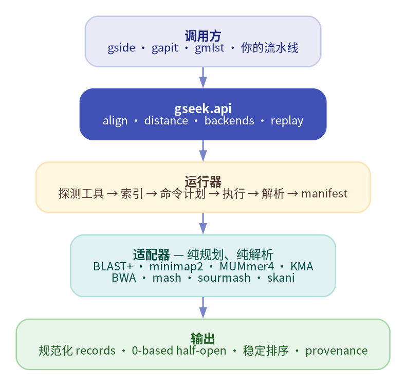

<div class="gseek-hero" markdown>

# gseek

**八种 DNA 工具，一个可复现的比对层。**

`gseek` 把 BLAST+、minimap2、MUMmer4、KMA、BWA、mash、sourmash 与 skani
统一到同一套 request/result 模型，提供内容寻址索引、无损 records 与可回放
manifest。纯 Python 实现，零运行时依赖。

<span class="gseek-badge">Python ≥ 3.12</span>
<span class="gseek-badge">8 个后端</span>
<span class="gseek-badge">仅标准库</span>
<span class="gseek-badge">MIT</span>

[快速开始](quickstart.zh.md){ .md-button .md-button--primary }
[教程](tutorial.zh.md){ .md-button }
[API 参考](api.zh.md){ .md-button }

</div>

## 为什么需要 gseek

<div class="grid cards" markdown>

-   **统一 record 模型**

    ---

    BLAST outfmt、PAF、SAM、KMA 与 MUMmer 的输出归一化为同一套
    `AlignmentRecord` / `DistanceRecord`；坐标、identity 与 coverage 都保留来源。

-   **内容寻址索引**

    ---

    索引 key 包含适配器版本、语义参数、target 内容哈希与工具版本。不依赖
    mtime，并发构建有文件锁。

-   **可回放 manifest**

    ---

    每次运行都可写出 `gseek.run/1`，记录输入、命令、工具版本、结果哈希与
    allowlist 环境。`verify` / `replay` 校验证据，而不是相信日志。

-   **零运行时依赖**

    ---

    `gseek` 只使用 Python 标准库；外部比对工具保持独立，运行时发现，缺失时
    给出可操作的错误提示。

</div>

## 整体结构



*调用方共享同一套 API；适配器只规划命令、解析输出；生物学规则留在调用方。*

## 后端

| 后端 | 输入 | 索引 | 操作 |
| --- | --- | --- | --- |
| `blast` | FASTA | target | 比对（DNA/蛋白任务） |
| `minimap2` | FASTA / FASTQ / paired | target | 比对 |
| `kma` | FASTA / FASTQ / paired | target | 比对 |
| `mummer` | FASTA | 无 | 比对（MUMmer 4） |
| `bwa` | FASTA / FASTQ / paired | target | 比对 |
| `mash` | FASTA / FASTQ | sketch | 距离 / screen |
| `sourmash` | FASTA / FASTQ | sketch | search / gather |
| `skani` | FASTA | sketch | ANI 距离 |

## 安装

```bash
pip install gseek==0.10.2
gseek --version
gseek doctor
gseek backends --json
```

`doctor` 会探测所有外部工具，缺失时以非零状态退出。`backends --json` 是机器可读
的能力矩阵。

## 第一次调用

```python
from pathlib import Path

import gseek

result = gseek.align(
    backend="minimap2",
    query=Path("sample.fna"),
    target=[Path("scheme/alleles.fna")],
    preset="asm5",
    threads=8,
    index="auto",
    manifest=Path("runs/sample.manifest.json"),
)

print(result.stats.record_count)
for hit in result.records:
    print(hit.query_id, hit.target_id, hit.identity)
```

## 从这里开始

<div class="grid cards" markdown>

-   **快速开始**

    ---

    安装 gseek，完成第一次 CLI 或 Python 比对。

    [快速开始](quickstart.zh.md)

-   **教程**

    ---

    完整流程：索引、距离、manifest、replay 与错误处理。

    [教程](tutorial.zh.md)

-   **API 参考**

    ---

    公共函数、结果模型、适配器协议与 schema。

    [API 参考](api.zh.md)

-   **CLI 参考**

    ---

    子命令、JSON 输出、退出码与自动化约定。

    [CLI 参考](cli.zh.md)

-   **错误模型**

    ---

    类型化异常、`gseek.error/1` 与稳定的进程退出码。

    [错误模型](errors.zh.md)

-   **兼容性**

    ---

    通过 `legacy | gseek | shadow` 迁移 gside、gapit 或 gmlst。

    [兼容性](https://github.com/indexofire/gseek/blob/main/dev/compatibility.md)

</div>

## 为生态系统而建

`gseek` 是 [gside](https://github.com/indexofire/gside)、
[gapit](https://github.com/indexofire/gapit) 与
[gmlst](https://github.com/indexofire/gmlst) 共用的比对层。调用方保留自己的
阈值、allele calling 与物种规则；gseek 负责让证据可复现。

## 开发

- [开发计划](https://github.com/indexofire/gseek/blob/main/dev/development-plan.md)
- [适配器矩阵](https://github.com/indexofire/gseek/blob/main/dev/adapter-matrix.md)
- [兼容性迁移](https://github.com/indexofire/gseek/blob/main/dev/compatibility.md)
- [AGENTS.md](https://github.com/indexofire/gseek/blob/main/AGENTS.md)——TDD 与架构约定。
